# Electrode EDS Spatial Analyzer

單檔離線的電極 EDS 二維空間量化工具。不需安裝、不需網路，資料不離開本機。

> 本頁所有截圖都是程式產生的**合成示範影像**，不是量測資料。

## 取得與開啟

整個工具只有一個檔案：[`dist/Electrode_EDS_Analyzer.html`](dist/Electrode_EDS_Analyzer.html)（約 200 KB）。

1. 下載這個檔案，方式擇一：
   - **建議**：到 [Releases](https://github.com/kluorvoeDing/electrode-eds-spatial-analyzer/releases) 頁，在最新版本的 Assets 下點 `Electrode_EDS_Analyzer_vX.Y.Z.html`。檔名帶版本號，內容與 `dist/` 裡的相同。
   - 或點上面的連結開啟檔案頁，按右上角的 **Download raw file**（下載圖示）。
   - 或在 repo 首頁按 **Code → Download ZIP**，解壓縮後取出 `electrode-eds-spatial-analyzer-main/dist/Electrode_EDS_Analyzer.html`。請先解壓縮，不要直接在壓縮檔檢視視窗裡開啟。
2. 把這個 HTML 傳進 VDI（其餘檔案都是原始碼與測試，使用時不需要）。
3. 雙擊，以 Chrome 或 Edge 開啟。右下角會顯示版本號。

之後有新版時，重複同樣步驟換掉這個檔案即可。

## 使用說明

三個步驟：**資料 → 確認遮罩 → 分析**。每一步左側都有一行說明，底部有「下一步」按鈕。

### 1. 選擇樣本條件

開啟後停在「1 資料」。選擇觀察方向（表面／截面）與添加物，右上方可填樣品名稱。

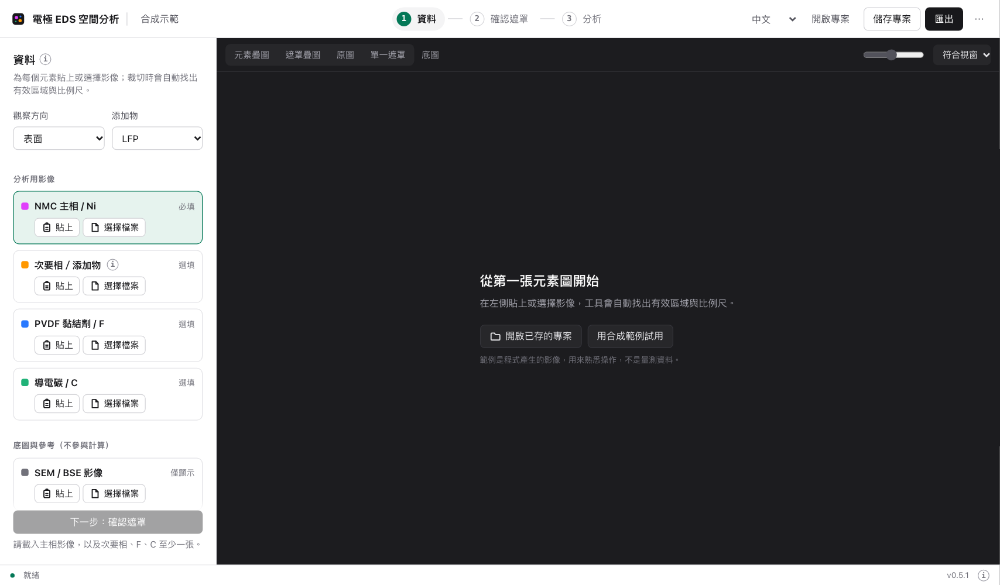

各元素圖放進對應的通道：

| 影像           | 放進哪個通道    | 用途                 |
| -------------- | --------------- | -------------------- |
| Ni             | NMC 主相 / Ni   | 分析                 |
| Fe（LFP 樣本） | 次要相 / 添加物 | 分析                 |
| F              | PVDF 黏結劑 / F | 分析                 |
| SEM / BSE      | SEM / BSE 影像  | 只當底圖，不進入指標 |
| C 等其他元素   | 其他元素        | 只供顯示             |

### 2. 貼上第一張元素圖，並輸入比例尺長度

在 VDI 內複製元素圖或截圖，點該通道的「貼上 / Ctrl+V」，再按 Ctrl+V；也可以用「選擇檔案」（Choose File）選檔。

「裁切與對位確認」會自動做兩件事：

- **框出有效區域**（青色框），標題、標籤與比例尺被排除在外。
- **找出比例尺**（橘色線）。請在「圖上標示的長度」填入比例尺旁邊印的數字，例如 25，工具就換算出 μm／像素。

位置正確就勾選「我已確認…」，按「確認並匯入通道」。

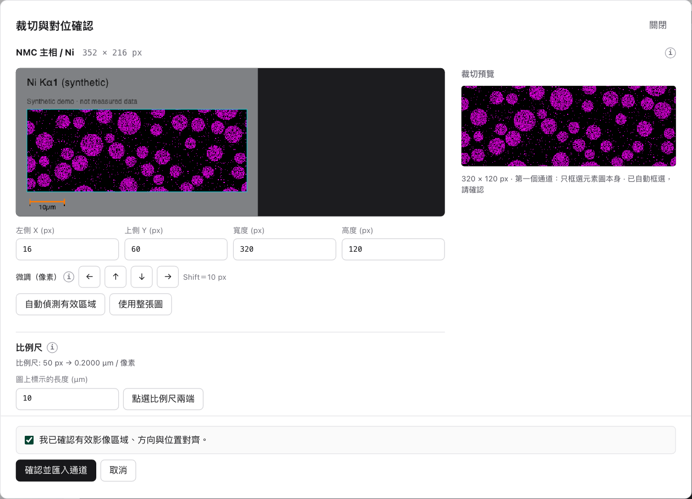

- 框偏了可以拖曳、輸入數值，或按「自動偵測有效區域」重來。
- 橘線沒有落在比例尺上時，按「點選比例尺兩端」，在圖上點兩下。
- 比例尺只需要填一次。沒有比例尺的輸入（例如 CSV）可在「1 資料」頁最下方直接輸入 μm／像素；不填時距離以像素顯示。

### 3. 貼上其餘元素圖

第二張起，框的大小**鎖定為與第一張相同**，拖曳只會移動位置，所以各通道尺寸一定一致。右側是與參考通道的混合預覽，用來檢查位置有沒有對上。

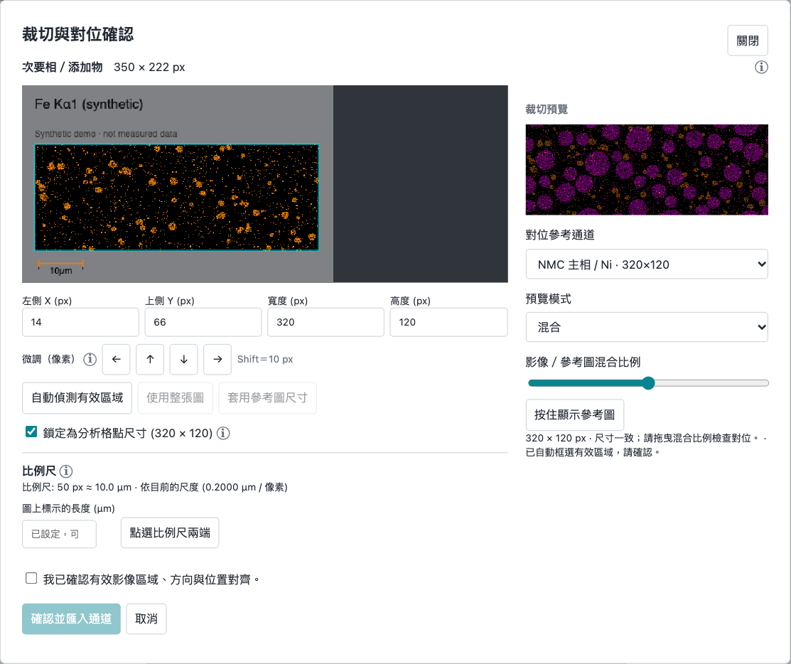

- 需要微調時用方向按鈕或鍵盤方向鍵，一次 1 px（按住 Shift 為 10 px）。
- 預覽模式可切換「混合」「差異」，或按住「按住顯示參考圖」來回比對。
- 比例尺欄位會顯示「依目前的尺度，這條比例尺約幾 μm」。數字和圖上印的一樣，就表示各張圖的倍率一致，不用再填。

### 4. 貼上 SEM

SEM 的倍率通常與元素圖不同。工具會自動框出報表上白框內側的掃描範圍，並把它縮放成與元素圖相同的尺寸。確認顆粒位置與元素圖重合後匯入。

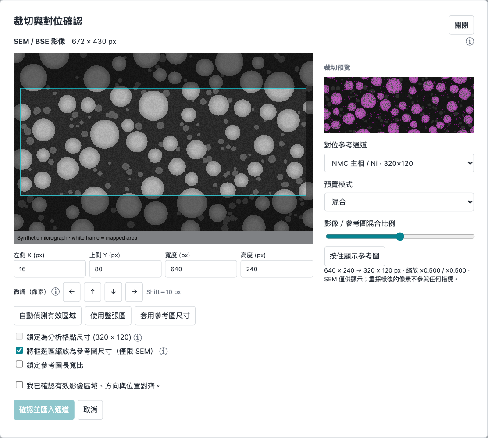

先貼 SEM 也可以：確認第一張元素圖後，會自動跳出 SEM 的縮放確認。

### 5. 檢查疊圖

匯入後，影像區顯示「元素疊圖」：元素圖以原色疊在 SEM 上。上方可勾選要顯示哪些元素（預設只顯示次要相）。影像下方是比例尺。

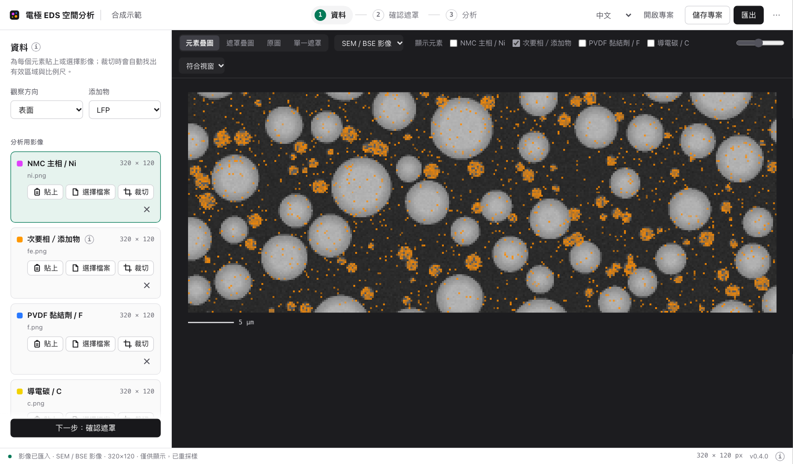

### 6. 確認遮罩

按「下一步」。彩色區域是工具判定「有這個元素」的位置，稱為遮罩；**所有數值都是從遮罩算出來的**。三個元素各用一種顏色，左側列出各自佔影像的比例。

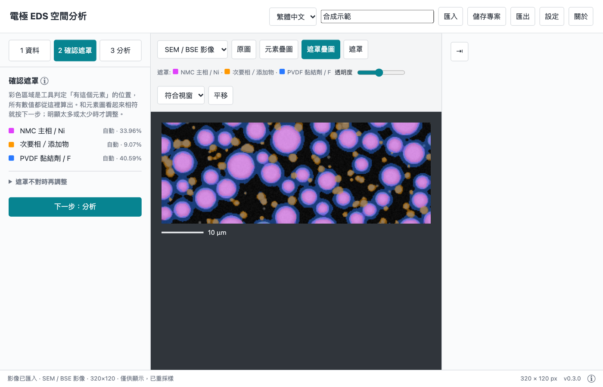

這一步通常不需要操作：把遮罩和 SEM、元素圖對照，主相的顏色蓋住顆粒、次要相的顏色落在它該在的位置，就按「下一步」。

只有明顯太多或太少時，才展開「遮罩不對時再調整」。展開後只顯示選定通道的遮罩，可以改用手動閾值，或調整平滑半徑。

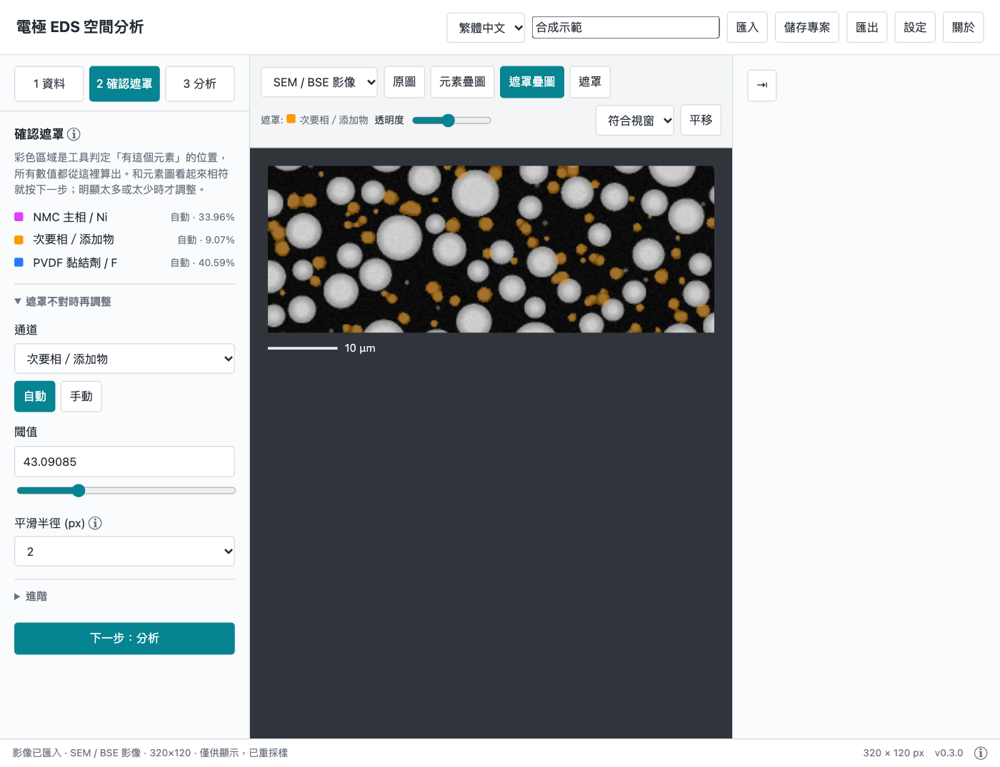

平滑半徑預設 2 px。EDS 元素圖是稀疏的計數點，不先平滑的話，遮罩只會挑出零星的亮點。半徑越大區域越完整、細節越少。

### 7. 分析

再按「下一步」，工具自動計算。影像上疊著網格，**每一格的數字是次要相在該格的面積比例**；右側是全區的數值，每個數字下面有一行說明。

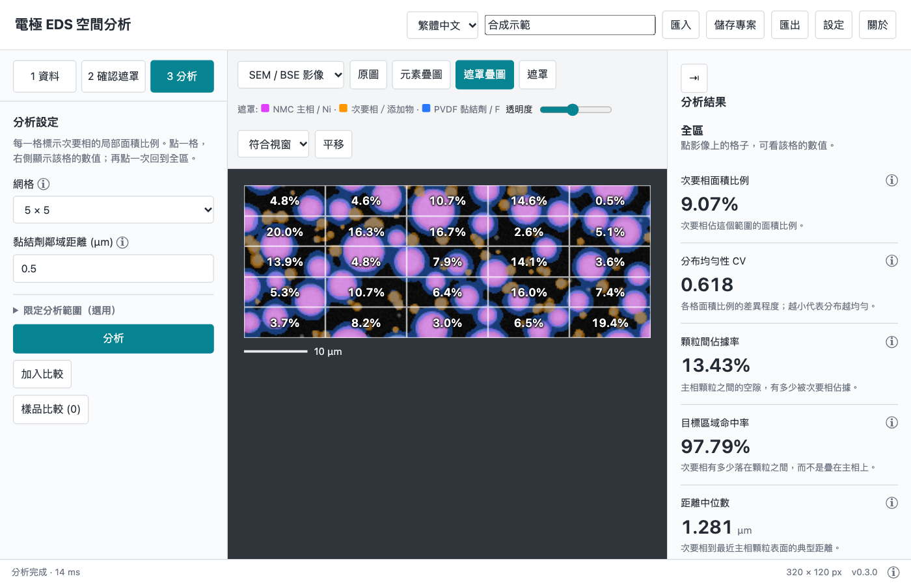

**點影像上的任一格**，右側改為顯示那一格的數值；再點一次，或按「全區」，回到全區。

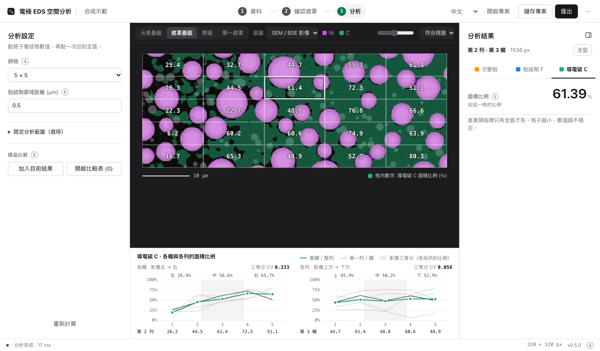

- 「網格」可選 3×3、5×5、8×8，改了會自動重算。格子越小，每格的像素越少，數值越不穩定。
- 「分布均勻性 CV」比較的是各格之間的差異，所以只有全區才有。
- 各指標旁的 ⓘ 有完整定義。

### 8. 儲存與匯出

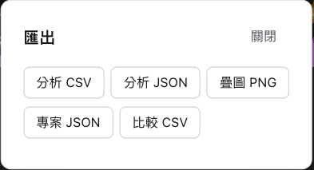

- **專案 JSON**（或右上「儲存專案」）：保存影像、設定與結果。之後在「1 資料」頁最下方按「載入專案」接續。
- **分析 CSV／JSON**：結果數值，包含每一格的數值。欄位名稱固定為英文，方便後續處理。
- **疊圖 PNG**：遮罩疊圖加上網格、每格比例與比例尺，下方附樣品名稱與主要指標。

### 影像上方出現黃色提示列時

表示有問題擋住了計算，最常見的是通道尺寸不一致。提示列會寫出是哪個通道、應該多大；按旁邊的「修正…」按鈕，在跳出的視窗確認即可。

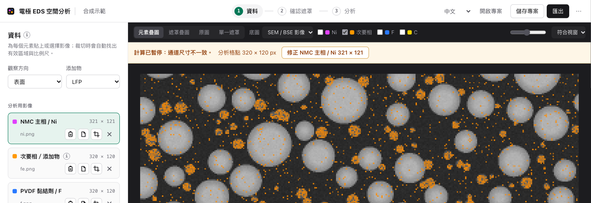

### 限定分析範圍（選用）

裁切準確時，分析的就是整張影像，不需要另外設定範圍。只有影像裡包含不該計入的部分（例如截面圖的集流體、空白或破損區）時，才在「3 分析」頁展開「限定分析範圍（選用）」，按「繪製」拖出矩形或多邊形；勾選「排除區域」則是把畫出的部分扣掉。

### 會清除分析範圍與尺度的操作

- **重新裁切**同一張影像（Ni、次要相、F）：清除分析範圍；**尺度不變**。
- 把分析通道**換成另一張影像**：清除分析範圍與尺度。裁切視窗會先提醒，填入新影像的比例尺長度即可保留尺度。
- 分析通道的影像尺寸改變：清除分析範圍。

更換、重新貼合或移除 SEM／其他元素不會清除。取消裁切不會取代原資料。「設定 → 重設工作區」會清空目前所有資料（工具不在本機儲存任何內容）。

### 判讀前提

自動框選、比例尺與遮罩都只是起始建議，請逐一確認。尺寸相同不保證已對位；比例尺的量測誤差約 ±1 像素。確認完成前，數值不能當作實驗結論。結果只有 2D 影像意義，不能直接推論三維、化學鍵結或 cohesive 因果。

## 補充說明

### 介面語言

預設繁體中文；頂端語言選單可切換 English。按鈕、指標、資訊提示、對話框與狀態訊息同步切換，並保留已載入資料、ROI、設定與分析結果。Session JSON 儲存語言；舊版 Session 未指定語言時沿用當前介面。CSV／Analysis JSON 欄位名稱維持固定，便於後續處理。

### 輸入格式

PNG / JPEG 或無表頭、矩形、有限數值 CSV。所有 channel 必須尺寸相同並事先完成空間對位。CSV 保留原始 intensity；圖片使用 max(R,G,B)，避免純色 EDS 訊號受 luminance 權重影響。彩色 LUT 與圖片壓縮可能改變 intensity，科學分析優先使用 CSV。

分析通道保留裁切區域的原始像素，不拉伸、不自動對位。取閾值前的平滑只用來決定遮罩，不改變儲存的像素。SEM/BSE 只作顯示底圖，不進入任何指標；縮放時縮小採面積平均、放大採雙線性內插，縮放比例記錄在 Session 與 trace。

### 貼上與隱私

全程本機離線；只接收使用者主動貼上的影像，不解密檔案、不擷取螢幕。VDI 剪貼簿可用性以企業環境設定為準。Session 保存原始貼上影像、裁切座標及人工確認紀錄，Analysis trace 保留來源 hash、裁切資訊與確認時間。

各圖應使用相同顯示倍率、相同掃描範圍與方向。截圖中的比例尺與影像一起縮放，所以用截圖上的比例尺換算仍然正確。

私人 repo 不含公司原始實驗圖；synthetic data 僅用於驗證與本頁截圖。

## 開發

成品無執行期依賴。開發需 Node 20 以上：

- `npm install`：安裝開發工具（Playwright、Prettier）；另執行一次 `npx playwright install chromium`，或以 `CHROMIUM_EXECUTABLE_PATH` 指向既有 Chromium。
- `npm run build`：把 `src/` 串接成 `dist/Electrode_EDS_Analyzer.html`。來源順序列於 `build.mjs`；版本號取自 `package.json`。
- `npm run test:unit`：數值、裁切／重採樣、語言與管線快取的單元測試。
- `npm run test:browser`：先建置，再以離線 headless Chromium 依序執行 `tests/browser/` 下所有腳本。
- `npm test`：以上兩者。`npm run format`：Prettier。
- `npm run docs:shots`：以合成影像重新產生本頁截圖（`docs/images/`）。介面改動後執行。

原始碼為共用全域的 classic script：`src/analysis/core.js`（數值核心，Worker 與主程式共用）、`src/ui/`（語言、影像匯入與對位）、`src/app/`（狀態、Worker 呼叫、版面、各步驟面板、匯入、畫布、結果、Session、匯出、啟動）、`src/workers/worker.js`（訊息收發）。

## 驗證

詳見 `docs/validation.md` 與 `docs/algorithms.md`。

瀏覽器測試為開發依賴，正式 HTML 不需要。測試輸出寫入 `qa/`（不納入版本控管）；`node tests/synthetic/generate.cjs` 可重建合成 CSV。

Analysis JSON 為結果資料；要重載 maps、ROI、設定、comparison，請使用 **儲存專案 / 專案 JSON**。實驗前先以自己的 map 人工確認每個 overlay。
